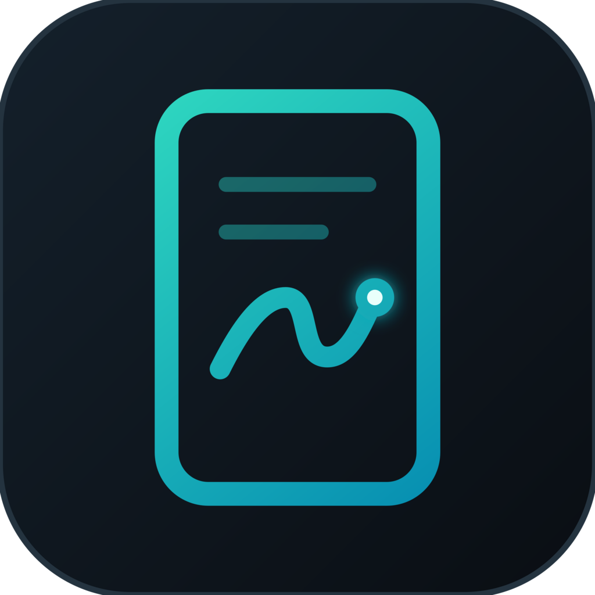
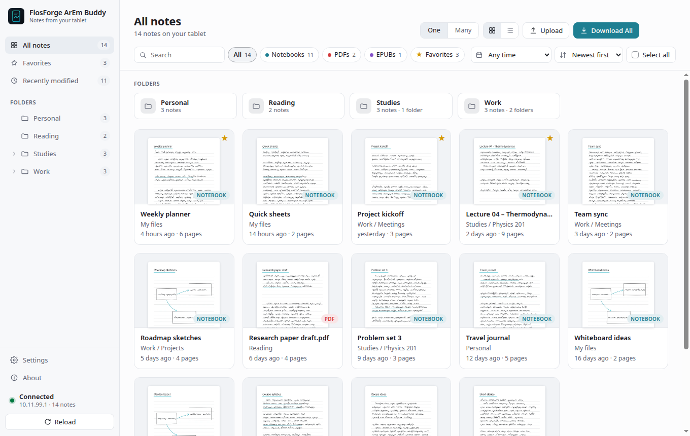
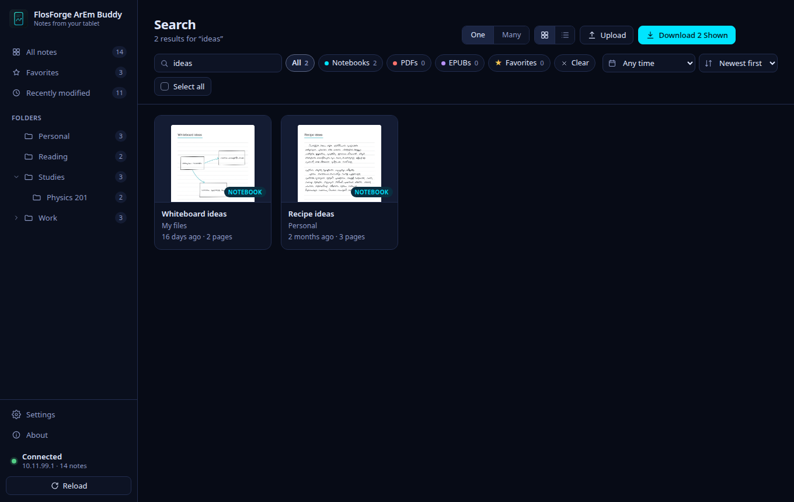
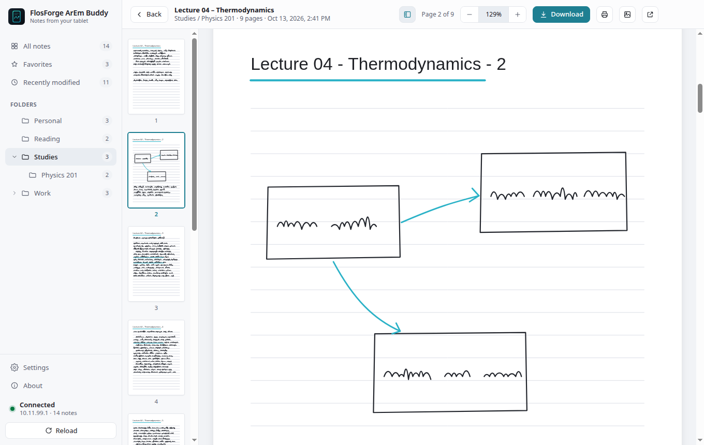
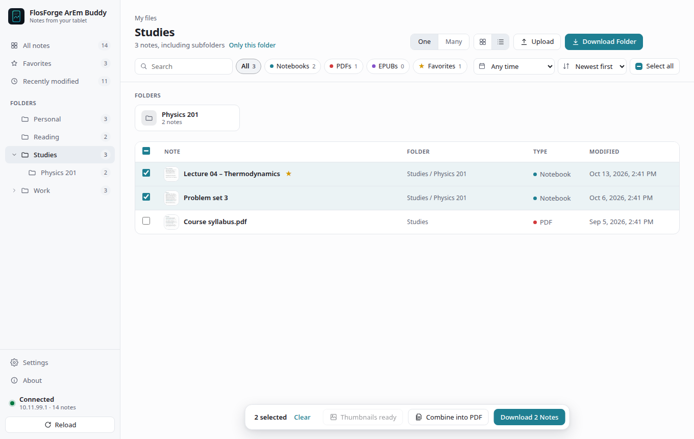
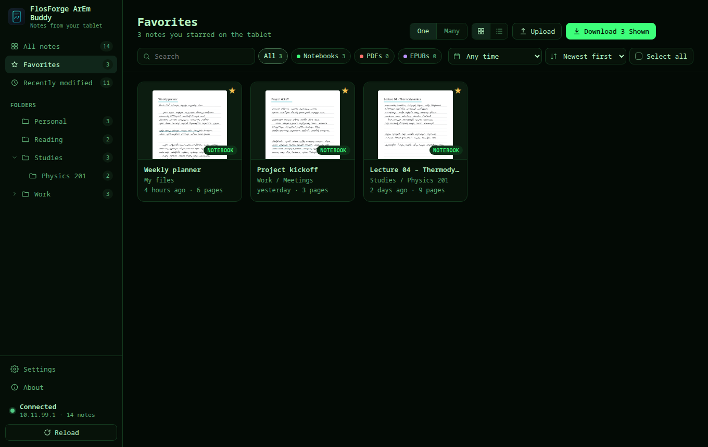
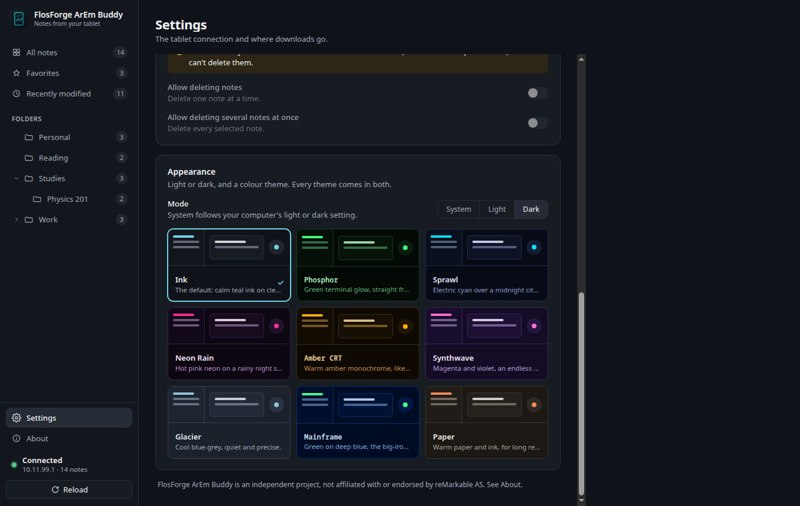
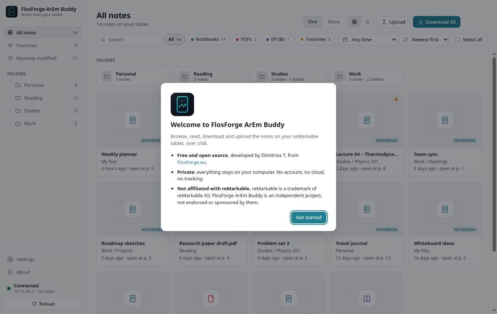
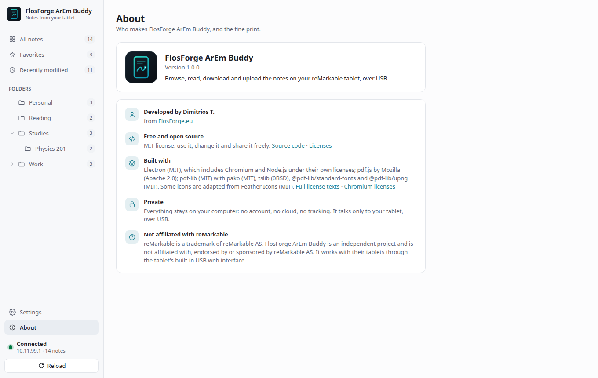

<p align="center">
  
</p>

<h1 align="center">FlosForge ArEm Buddy</h1>

<p align="center">
  A free, open-source desktop companion for your reMarkable tablet, for macOS, Windows and Linux, from FlosForge.<br/>
  Browse, read, search, download and upload your notes over USB. No account. No cloud. No telemetry.
</p>

> **A note on this project:** I built FlosForge ArEm Buddy for my own reMarkable and decided to share it openly under
> the MIT License. It's a personal project, provided as-is. You're welcome to [download it](#get-it), use it, and
> [fork it](#fork-it) to change or extend it however you like. [Bug reports](#reporting-a-bug) are welcome; the
> repository doesn't take pull requests, so forking is the way to change it.

<p align="center">
  
  
</p>

## Why

Getting notes off a reMarkable usually means going through a reMarkable account and its cloud, or through the
tablet's bare USB web page, one file at a time. FlosForge ArEm Buddy talks to that same USB web interface and adds
what I was missing:

- **Local:** it talks only to your tablet, over the USB cable. Your notes go from the tablet to a folder on your
  computer: `reMarkable_PDFs` in Google Drive's My Drive if you have Google Drive for desktop, so they're backed up,
  otherwise in Documents. You can pick any folder in Settings.
- **No account:** no sign-up, no login, no reMarkable cloud. On the tablet, turn on **Settings → Storage → USB web
  interface** and plug it in.
- **No telemetry:** no analytics, tracking or phoning home. The only network traffic is to the tablet.
- **Nothing in the background:** it checks for the tablet only while its window is open, and downloads only when you
  ask (or, if you turn it on, once when the tablet connects). Closing the window quits it.
- **No subscriptions:** free and open source under the MIT License, with nothing to pay and no paid tier.

FlosForge ArEm Buddy is an independent project, not affiliated with, endorsed by or sponsored by reMarkable AS.

## Features

- **Library:** every note on the tablet as a grid or a list, with thumbnails, a folder tree, favorites (the ones you
  starred on the tablet) and recently modified. Filter by type, favorite and date; sort by date, name or folder.
- **Search:** note and folder names, and the text inside notes you've downloaded or opened (typed text, imported
  PDFs and EPUBs, and handwriting you converted on the tablet). Ignores case and accents, and shows the matching line.
- **Reader:** pages drawn in the app's theme, with page thumbnails, zoom, **Print**, **Open in PDF app** and
  **Export as PNG**.
- **Download:** notes, folders, a filtered view or the whole tablet as PDFs, in the same folders as on the tablet.
  Unchanged notebooks are skipped, and identical files are left untouched so Drive doesn't upload them again.
  - **.rmdoc backups:** each notebook in reMarkable's own format too, which you can upload back, pen strokes and all.
  - **Older versions:** a notebook's previous copy moves to a dated `_versions` folder instead of being replaced.
  - **When the tablet connects:** download everything once, automatically.
- **Upload:** PDFs, EPUBs and `.rmdoc` files, with a button or by dragging them onto the window, a folder tile or a
  folder in the sidebar.
- **Combine into PDF:** join several notes into one PDF, in the order shown.
- **Several tablets:** save their addresses by name and switch between them.
- **Troubleshooting:** clear connection states with the likely fix, and the tablet's own log saved to a file.
- **Themes:** System, Light or Dark, and nine colour themes shared with the other FlosForge apps.

## Get it

### Download

Ready-made apps are on the **[Releases page](https://github.com/dimitriostzr/flosforge-arem-rm-tablet-helper/releases/latest)**:

| System | File |
|---|---|
| macOS, Apple silicon | `FlosForge-ArEm-Buddy-macOS-<version>-arm64.dmg` |
| macOS, Intel | `FlosForge-ArEm-Buddy-macOS-<version>-x64.dmg` |
| Windows 10/11, Intel/AMD | `FlosForge-ArEm-Buddy-Windows-<version>-x64.zip` |
| Windows 11 on ARM | `FlosForge-ArEm-Buddy-Windows-<version>-arm64.zip` |
| Linux, x86-64 | `FlosForge-ArEm-Buddy-Linux-<version>-x86_64.AppImage` |
| Linux, ARM64 | `FlosForge-ArEm-Buddy-Linux-<version>-arm64.AppImage` |

The apps aren't signed with a paid Apple or Microsoft certificate, so your system warns you the first time:

- **macOS:** drag the app to Applications and open it once, then go to **System Settings → Privacy & Security** and
  click **Open Anyway**. When macOS asks whether the app may find devices on your local network, allow it: the
  tablet's USB connection counts as one.
- **Windows:** unzip the folder anywhere (for example into Documents) and run `FlosForge ArEm Buddy.exe` inside it.
  SmartScreen warns about an unknown publisher: click **More info**, then **Run anyway**. To remove the app, delete
  the folder.
- **Linux:** make the AppImage executable (`chmod +x FlosForge-ArEm-Buddy-*.AppImage`) and run it. Without FUSE,
  start it with `--appimage-extract-and-run`; if it closes straight away with a message about the sandbox, add
  `--no-sandbox`.

### Build it yourself

You need [Node.js](https://nodejs.org) 22.13 or later and git.

```bash
git clone https://github.com/dimitriostzr/flosforge-arem-rm-tablet-helper.git
cd flosforge-arem-rm-tablet-helper
npm install
npm start              # run it straight away, or package it:
npm run dist           # this computer's system: .dmg on a Mac, Setup.exe on Windows, AppImages on Linux
npm run dist:linux     # Linux AppImages (x86-64 and ARM64), from any system
npm run dist:win-zip   # Windows zip folders (x64 and ARM64), from any system
```

The apps end up in `release/`. More in [Development](#development).

## Using it

- **Sidebar:** Library (All notes, Favorites, Recently modified), an expandable folder tree
  with note counts, Settings, and the connection status with **Reload**.
- **Main area:** a grid or list of notes under a page title, with folder tiles, breadcrumbs
  and sorting. Search (⌘F / Ctrl F) matches note and folder names, and the text inside notes
  that have a PDF on this computer (downloaded or opened), ignoring case and accents. A note
  found by its text shows the matching line. Handwriting has no text unless it was converted on
  the tablet; typed text, imported PDFs and EPUBs do.
  Filters cover type (chips with counts), favorites, modified date and include subfolders;
  from inside a folder, a search can be limited to that folder.
- **Reading:** double-click a note (or press Enter) to open it in the reader, which draws the
  pages itself with pdf.js so it follows the app's theme. It has a page counter, zoom
  (⌘+ / ⌘− / ⌘0 for fit width), **Download** (saves the note like any other download),
  **Print** (⌘P / Ctrl P: the system print dialog, one page per sheet) and **Open in PDF app**.
  A copy from an earlier download is used when it's current; otherwise the tablet exports it,
  and the PDF is cached until the note changes. Notes with more than
  one page get a strip of page thumbnails on the left (the **Pages** button hides it): click
  one to jump there; ← / → go to the previous / next page. **Export as PNG** (the picture
  button) saves every page as `Note - page 01.png` into a folder you pick. Clicking anything
  in the sidebar, or Esc, closes the reader.
- **Uploading:** **Upload** in the header, or drag files onto the window, puts PDFs, EPUBs
  and `.rmdoc` files on the tablet, in the folder you're viewing (or the top level). Drop them
  on a folder tile, a folder in the sidebar, or **All notes** (the top level) to put them
  there instead. Uploading a `.rmdoc` backup restores that notebook, pen strokes and all. Folders
  can't be created from here: the tablet's USB web interface has no way to make one, so make
  them on the tablet.
- **Selecting:** the **One | Many** switch in the header. One (the default) works like
  Finder: a click selects one note, ⌘/Ctrl-click adds, Shift-click selects a range, a click on
  empty space clears. Many: every click adds. Checkboxes always add. Double-click a folder in
  the sidebar to open or close its subfolders.
- **About:** who makes the app, its license, the software it's built with (with their
  licenses), privacy, and the trademark notice. A short welcome dialog says the essentials on
  first launch.
- **Downloading:** select notes (click, shift-click for a range, ⌘A for everything shown) and
  use the selection bar, or use the header button. It reads **Download All** for the whole
  tablet, **Download Folder** inside a folder, or **Download *n* Shown** for a filtered view.
  Folders are mirrored under the save-to folder, e.g. `Work - Projects/2026/Sketches.pdf`.
  Progress and the result appear at the bottom only while relevant.
- **Combine into PDF** (selection bar, two or more notes): joins the selected notes into one
  PDF, in the order shown, saved where you choose. Notes without a current PDF here are
  exported from the tablet first.
- **Stop** finishes the notebook that's downloading, then stops. Interrupting the tablet
  mid-export can leave it unresponsive for minutes. That's also why closing the window
  during a download asks first.
- **Settings** (⌘, / Ctrl ,):
  - **Tablet address** (default `http://10.11.99.1`, with Test and Reset to default).
    **Saved tablets** keeps addresses under a name (up to 20); **Use** switches to one, and
    the sidebar shows its name. **Save Log…** saves the tablet's own log (`/log.txt`) with
    the app version and address on top, for troubleshooting.
  - **Downloads:** the save-to folder and four switches:
    - **Skip notebooks that haven't changed** (on by default).
    - **Also save .rmdoc backups** (off): each notebook in reMarkable's own format too, next
      to its PDF (`Work/Sketches.rmdoc`), re-fetched only when the notebook changes. On
      firmware without `/rmdoc`, PDFs are still saved and the result says so.
    - **Keep older versions** (off): when a notebook changed, its previous PDF (and
      `.rmdoc`) moves to `_versions/` in the save-to folder, under the same folders and dated
      by when it was last edited, e.g. `_versions/Work/Sketches (2026-10-01 09.30).pdf`.
      Content that didn't change is never versioned.
    - **Download everything when the tablet connects** (off): once per connection, when the
      tablet is plugged in or the app starts with it connected, while the window is open.
  - **Deleting notes** shows two switches (deleting one note, deleting several), off and
    greyed out, with a note that the USB web interface can't delete: it has no request for it,
    so the app can't remove anything from the tablet.
- **Appearance** (in Settings): System / Light / Dark, and nine colour themes, each in light
  and dark: Ink (default), Phosphor, Sprawl, Neon Rain, Amber CRT, Synthwave, Glacier,
  Mainframe and Paper. They're shared with FlosForge Radar (`src/themes.json`), and
  `npm test` checks every palette for WCAG contrast. Themes are named after a mood or an
  object, never after a film, game, book or product.

The USB web interface doesn't provide tags or page counts. Cards show the tablet's own
thumbnail where the firmware has `/thumbnail/{ID}`, until a PDF of the note is on this computer;
then page 1 is drawn from it, with the page count. Without either, cards show the page that was
last open on the tablet.

## How it talks to the tablet

| Request | Used for |
| --- | --- |
| `GET /documents/` | top-level folders and notebooks |
| `GET /documents/{folderID}` | a folder's contents (what the tablet's own web UI uses) |
| `GET /download/{ID}/pdf` | the notebook rendered as PDF; falls back to `/download/{ID}/placeholder` on firmware without it |
| `GET /download/{ID}/rmdoc` | the notebook in reMarkable's format, for **.rmdoc backups** |
| `GET /thumbnail/{ID}` | a note's thumbnail; after three notes without one, the app stops asking that tablet |
| `GET /log.txt` | the tablet's log, for **Save Log…** |
| `POST /upload` | uploads, into the folder listed just before |

Two quirks of the tablet's web server (seen on a Paper Pro) are worked around:

- A request on its own can sit for ~10 s and get `408 request timeout`; while another
  connection to the tablet is open it's answered at once. The client holds one idle
  "wake" connection open while a request is in flight.
- Downloads come with both `Content-Length` and `Transfer-Encoding: chunked`, which is
  invalid HTTP and rejected by `fetch()`. Downloads use Node's lenient HTTP parser, which
  follows the chunked framing like browsers and curl do.

How downloads are saved:

- PDFs stream into a hidden temp file next to their destination and are renamed into place,
  so a half-written PDF is never left behind.
- Names are sanitized (`/ \ : * ? " < > |` and control characters → `-`). Duplicate names in
  one folder get a short ID suffix, e.g. `Meeting notes (a1b2c3d4).pdf`. A download never
  replaces a file it didn't make: not another notebook's, and not one of yours that happens to
  have the same name (the notebook gets the ID suffix instead). Names Windows reserves (`CON`,
  `NUL`, `COM1`…) get a dash, and a tablet folder called `_versions` is saved as
  `_versions (tablet)`.
- `.remarkable-sync.json` in the save-to folder records what was downloaded: modified date,
  size and SHA-256. When a download turns out byte-identical to the existing file, that file
  is left untouched, so Google Drive doesn't re-upload it. Renamed or moved notebooks replace
  their old file (with **Keep older versions** on, an old file with other content goes to
  `_versions/`). Notebooks deleted on the tablet are kept locally.

## Connection states

| Shown as | Meaning |
| --- | --- |
| Not connected | Nothing at the address: cable, USB web interface setting, or address |
| Not responding | Something accepts connections but doesn't answer, or answers HTTP 408. Seen while the tablet is asleep or still exporting a PDF. Wake it; if it persists, toggle USB web interface off and on, or replug |
| Connected | Browsing and downloading available |

A failed notebook (HTTP error, not a PDF, stalls > 60 s while the tablet is still up, or on
Windows its PDF is open in another app) is listed in the result and the rest continue. If the tablet goes away mid-run, or the save-to folder
isn't writable, the run stops with a clear message, and PDFs already saved stay.

## Reporting a bug

Found something that doesn't work? [Open a bug report](https://github.com/dimitriostzr/flosforge-arem-rm-tablet-helper/issues/new/choose). The form asks for your tablet
model and software version, your system and the app version, which is usually what it takes to find the cause.
If you can, attach the tablet's log (**Settings → Save Log…**); look it over first, as it can contain notebook
names.

Can't connect at all? [Connection states](#connection-states) covers the usual causes. It's a personal project, so
replies can take a few days, and feature requests may not happen; the code is yours to [fork](#fork-it).

## Your data

- **Your notes:** PDFs (and `.rmdoc` backups, and `_versions/`) go to the save-to folder, mirroring the tablet's
  folders. It's set by the first download and can be changed in Settings. `.remarkable-sync.json` there records what was downloaded, so a later download
  only fetches what changed.
- **The app's own files:** settings, the reader's PDF cache, thumbnails and the search text live in the app's data
  folder: `~/Library/Application Support/FlosForge ArEm Buddy` on macOS, `%APPDATA%\FlosForge ArEm Buddy` on
  Windows and `~/.config/FlosForge ArEm Buddy` on Linux. Deleting that folder resets the app; your downloaded notes
  stay.
- **The tablet:** the app only reads from it, except when you upload. It can't delete, rename or move anything
  there (the USB web interface has no way to), so Settings shows deleting as unavailable.

## More screenshots

| | |
| --- | --- |
|  |  |
|  |  |
|  |  |
|  |  |

The notes in these screenshots are made up. `npm run screenshots` retakes them: it runs the
real app against the mock tablet with a fake library (`scripts/screenshots.js`).

## Development

### Run from source

```sh
npm install
npm start
npm test            # sync-engine tests against a mock tablet (no Electron needed)
```

Without a tablet:

```sh
npm run mock-tablet   # terminal 1: fake tablet on http://127.0.0.1:8099
npm run start:mock    # terminal 2: app pointed at it (RM_HOST, this session only)
```

On macOS, `npm start` first renames the development copy of Electron (in `node_modules`) to
"FlosForge ArEm Buddy" and re-signs it ad hoc, so the menu bar and the Dock show the app's name
(`scripts/dev-mac-name.mjs`). Release builds are named by electron-builder.

### Release builds

```sh
npm run dist          # installers for this OS in release/ (Mac: a .dmg each for Apple silicon and Intel)
npm run pack          # just the unpacked app, quicker
npm run dist:linux    # Linux AppImages (x86-64 and ARM64), from any OS
npm run dist:win-zip  # Windows as zip folders (x64 and ARM64), from any OS
```

`npm run dist` on Windows also makes a `Setup.exe` installer. Elsewhere that needs Wine, so the
releases ship Windows as a zip.

Without an Apple Developer ID certificate the Mac app is signed ad hoc. That runs on the Mac
that built it. Copied to another Mac, it's blocked by Gatekeeper until the user clicks
**Open Anyway** in System Settings → Privacy & Security. To sign and notarize, set
`CSC_LINK`/`CSC_NAME` (and Apple notarization credentials) before `npm run dist`.

The app icon follows the FlosForge brand style (dark plate, teal outline, glowing accent, edge
to edge). It's drawn in `scripts/make-icons.mjs`; `npm run icons` (ImageMagick 7 with
librsvg) writes `resources/icon.svg`, `icon.png`, `icon.ico`, `icon.icns` and the Icon
Composer icon `resources/icon.icon`. macOS 26 and later show `.icns`-only apps shrunk onto a
grey tile, so on a Mac with **Xcode 26 or later** `npm run dist` builds with `icon.icon`
instead (it says which it used); without Xcode you get the classic icon.

Every Electron app starts from the same executable, and macOS Local Network privacy tells apps
apart by their executables' UUIDs, so it can't tell them apart. It then never asks and blocks
the app with `EHOSTUNREACH`. The build gives this app's executables UUIDs of their own
(`scripts/after-pack.cjs`, before signing), and `npm start` does the same to the
development Electron.app.

> **Install on the machine that runs the app.** `node_modules/electron` holds a binary for one
> OS. If the folder is shared between a Mac and a Linux VM, run `npm install` on the side you
> start it from (`spawn ENOEXEC` means it was installed for the other OS).
>
> **macOS: "Not connected" although the tablet works in a browser?** macOS asks before an app
> may talk to devices on local networks, and the tablet's USB connection counts as one. Allow
> FlosForge ArEm Buddy when asked, or later in
> **System Settings → Privacy & Security → Local Network**. If it's never asked, the build
> is older than the per-app UUIDs above: rebuild.
>
> If `npm start` prints "Electron APIs unavailable", your terminal exports
> `ELECTRON_RUN_AS_NODE=1` (some IDE terminals do). Run `unset ELECTRON_RUN_AS_NODE` first.

### Project layout

```
main.js              Electron main: window, connection checks, downloads, reader, IPC
src/remarkable.js    HTTP client for the USB web interface (native fetch + timeouts)
src/sync.js          Download engine (plain Node, unit-tested)
src/sanitize.js      File-name sanitizing
src/config.js        Settings (save-to folder, tablet address, saved tablets, switches) in userData/config.json
src/textindex.js     Text inside notes, for search (userData/text, per note version)
src/combine.js       Combine into PDF (pdf-lib)
src/errors.js        Error classification + user-facing messages
renderer/            The window (app.html/js/css), reader (pdf-view.mjs), tokens (style.css), preload
resources/           App icon (icon.svg is the source; see npm run icons)
scripts/             make-icons.mjs, dist.mjs, after-pack.cjs + mac-bundle.cjs (macOS UUIDs), screenshots.js
test/                node:test suite + mock tablet
```

## Fork it

FlosForge ArEm Buddy is free and open-source software under the **[MIT License](LICENSE)**. Copyright © 2026
Dimitrios T. (FlosForge.eu).

In plain words:

- **Use it** for anything, including at work, for free.
- **Change it** however you like in your own copy.
- **Share it**, changed or not, as long as the license and copyright notice go with it.
- **Name and logo:** the license covers the code, not the FlosForge name or logo. If you publish a fork, give it its
  own name and icon so nobody mistakes it for this project.

Build it, use it, build on it. If it doesn't do what you need, the fix lives in your own copy:

1. Fork the repository (or just download it).
2. Read [Project layout](#project-layout) to see where each part lives.
3. Make it yours.

There's no support channel. [Bug reports](#reporting-a-bug) are welcome, but the repository doesn't take pull
requests.

## Credits

FlosForge ArEm Buddy stands on the work of these projects:

- **[Electron](https://www.electronjs.org)** (MIT), with **Chromium** and **Node.js** inside it
- **[pdf.js](https://github.com/mozilla/pdf.js)** by Mozilla (Apache 2.0), for the reader, thumbnails and search text
- **[pdf-lib](https://pdf-lib.js.org)** (MIT), with @pdf-lib/standard-fonts, @pdf-lib/upng and
  **[pako](https://github.com/nodeca/pako)** (MIT) and **[tslib](https://github.com/microsoft/tslib)** (0BSD), for
  Combine into PDF
- **[Feather Icons](https://feathericons.com)** (MIT): some interface icons are adapted from it

The full list, with every license text, is in **[THIRD_PARTY_NOTICES.md](THIRD_PARTY_NOTICES.md)** and in the app
under **About → Full license texts**. Every copy of the app also carries Electron's, Chromium's and Node.js's
licenses (`LICENSES.chromium.html`, **About → Chromium licenses**).

To build it: [electron-builder](https://www.electron.build) (MIT), and for `npm run icons`, ImageMagick and librsvg.
None of these are included in the app.

## Legal & disclaimers

- **Use at your own risk:** the software is provided as-is, without warranty of any kind, under the license in
  [LICENSE](LICENSE). Keep your own backups of anything that matters.
- **Independent project:** FlosForge ArEm Buddy is **not affiliated with, endorsed by, or sponsored by reMarkable AS**.
  It works with their tablets only through the tablet's built-in USB web interface.
- **Trademarks:** reMarkable is a trademark of reMarkable AS. Other product and company names are trademarks of
  their respective owners. They appear only to say which devices and services the app works with, never to suggest
  endorsement.
